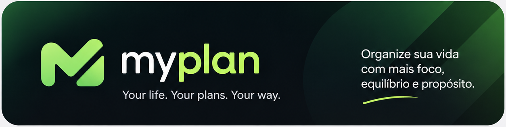

# myplan

**Sua vida. Seus planos. Sempre em foco.**

O myplan é um app para organizar tarefas pessoais.

## Estrutura

| Pasta | Conteúdo |
|---|---|
| [`api/`](api/) | API REST em Spring Boot, versões v1 e v2 |

A documentação da API, como rodar, os testes e o versionamento estão no [README da API](api/README.md).

## Entregas

Cada entrega da disciplina está marcada como uma release no GitHub: `entrega-1`, `entrega-2` e `entrega-3`.

Desenvolvido por Monique Coelho.
