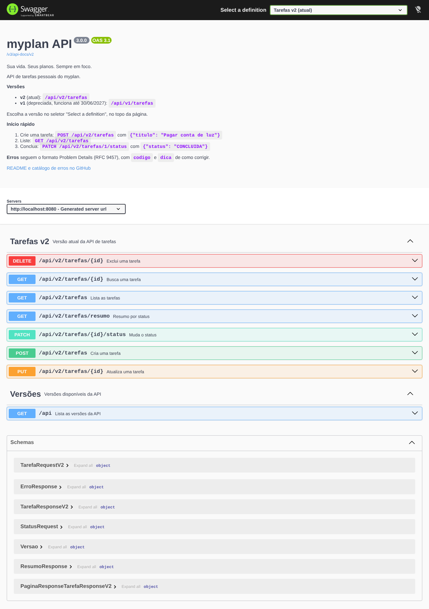
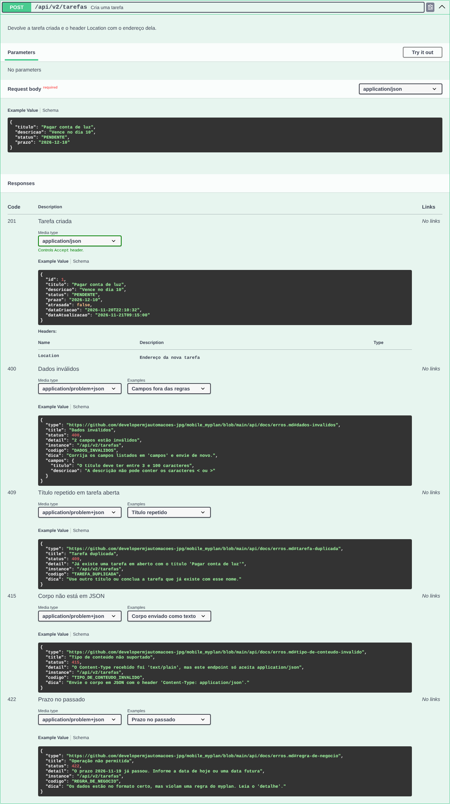

# myplan API

**Sua vida. Seus planos. Sempre em foco.**

Projeto autoral da disciplina Serviços Web e API Rest.

O myplan é um app de tarefas pessoais. Esta é a API dele, feita com Spring Boot: permite criar, listar, filtrar, atualizar, mudar o status e excluir tarefas.

## Entregas

| Entrega | Release | O que foi feito |
|---|---|---|
| 1 | `entrega-1` | Projeto Spring Boot e CRUD de tarefas com GET, POST, PUT e DELETE |
| 2 | `entrega-2` | Validações e regras de negócio, paginação, filtros e ordenação, PATCH de status, resumo, erros detalhados, logs e Actuator |
| 3 | `entrega-3` | Reestruturação em módulos e camadas, versionamento por URL (v1 e v2), erros no padrão Problem Details com dica de correção, documentação OpenAPI por versão com exemplos |

O histórico de mudanças está no [CHANGELOG](CHANGELOG.md).

## Guia de início rápido

**1. Rodar a API** (Java 17 ou mais novo):

```bash
./mvnw spring-boot:run
```

No Windows, use `mvnw.cmd spring-boot:run`. A API sobe em `http://localhost:8080`.

**2. Criar uma tarefa:**

```bash
curl -X POST http://localhost:8080/api/v2/tarefas \
  -H "Content-Type: application/json" \
  -d '{"titulo": "Pagar conta de luz", "prazo": "2026-12-10"}'
```

**3. Listar:**

```bash
curl http://localhost:8080/api/v2/tarefas
```

**4. Concluir:**

```bash
curl -X PATCH http://localhost:8080/api/v2/tarefas/1/status \
  -H "Content-Type: application/json" \
  -d '{"status": "CONCLUIDA"}'
```

Não há autenticação. Como o banco é H2 em memória, os dados são apagados quando a aplicação reinicia.

### Endereços úteis

| Endereço | Para quê |
|---|---|
| `http://localhost:8080` | Página inicial do myplan |
| `http://localhost:8080/swagger-ui.html` | Documentação interativa (Swagger), com seletor de versão |
| `http://localhost:8080/v3/api-docs/v2` | Especificação OpenAPI da v2 em JSON (`/v3/api-docs/v1` para a v1) |
| `http://localhost:8080/api` | Versões disponíveis da API |
| `http://localhost:8080/actuator/health` | Saúde da aplicação |
| `http://localhost:8080/h2-console` | Console do banco (JDBC URL `jdbc:h2:mem:myplandb`, usuário `sa`, sem senha) |

## Tecnologias

- Java 17 e Spring Boot 3.5
- Spring Web, Spring Data JPA e Bean Validation
- Spring Boot Actuator
- H2 (banco em memória)
- Springdoc OpenAPI (Swagger)
- JUnit 5 e MockMvc

## Estrutura do projeto

O código é organizado por **módulo** (cada funcionalidade em um pacote) e, dentro de cada módulo, por **camada**. O que é comum a toda a API fica em `shared`. Assim, um módulo novo (por exemplo `categoria` ou `usuario`) entra como um pacote ao lado de `tarefa`, sem mexer no que já existe.

```
src/main/java/br/com/myplan
├── MyplanApplication.java
├── tarefa/                         módulo de tarefas
│   ├── api/                        camada de controle (uma pasta por versão)
│   │   ├── v1/
│   │   │   ├── TarefaControllerV1.java
│   │   │   └── dto/                TarefaRequestV1, TarefaResponseV1
│   │   └── v2/
│   │       ├── TarefaControllerV2.java
│   │       └── dto/                TarefaRequest, TarefaResponse, StatusRequest,
│   │                               PaginaResponse, ResumoResponse
│   ├── service/                    regras de negócio (TarefaService)
│   ├── repository/                 acesso a dados (TarefaRepository)
│   ├── domain/                     modelo: Tarefa, StatusTarefa, DadosTarefa, ResumoTarefas
│   └── exception/                  exceções do módulo
└── shared/                         o que é comum a toda a API
    ├── api/                        VersoesController (GET /api)
    ├── config/                     OpenApiConfig, VersaoApiFilter, RequisicaoFilter
    └── exception/                  CodigoErro, ApiException, ErroResponse, GlobalExceptionHandler
```

| Camada | Responsabilidade | Depende de |
|---|---|---|
| `api` (controladores e DTOs) | Receber a requisição, validar o formato e montar a resposta da versão | `service`, `domain` |
| `service` | Regras de negócio, iguais para todas as versões | `repository`, `domain` |
| `repository` | Consultas ao banco com Spring Data JPA | `domain` |
| `domain` | Entidade e objetos do negócio | nada |

O serviço recebe e devolve objetos do domínio (`DadosTarefa`, `Tarefa`, `ResumoTarefas`) e não conhece os DTOs. Por isso a v1 e a v2 usam o mesmo serviço: cada controlador só converte o seu formato.

## Versionamento

A estratégia escolhida é **versionamento por URL**: a versão vai no caminho (`/api/v1/...` e `/api/v2/...`). Cada versão tem o seu controlador e os seus DTOs, então é possível mudar a v2 sem afetar quem usa a v1.

Escolhi a URL porque fica visível em qualquer cliente (navegador, Postman, logs), é fácil de testar e de documentar separadamente no Swagger.

| Versão | Endereço | Situação | Fim do suporte |
|---|---|---|---|
| v1 | `/api/v1/tarefas` | Depreciada | 30/06/2027 |
| v2 | `/api/v2/tarefas` | Atual | - |

### Headers de versão

| Header | Onde aparece | Exemplo |
|---|---|---|
| `API-Version` | Todas as respostas em `/api` | `2` |
| `Deprecation` | Respostas da v1 e do endereço sem versão | `true` |
| `Sunset` | Respostas da v1: data em que ela deixa de funcionar | `Wed, 30 Jun 2027 23:59:59 GMT` |
| `Link` | Respostas da v1 e do endereço sem versão: endereço equivalente na v2 | `</api/v2/tarefas>; rel="successor-version"` |

### Compatibilidade

- **A v1 mantém o contrato da primeira entrega:** a listagem é um array simples, sem paginação e sem o campo `atrasada`.
- **O endereço sem versão (`/api/tarefas`) continua funcionando** e responde como a v2, que é o formato que ele tinha na entrega 2. Ele devolve os headers `Deprecation` e `Link` para avisar que o certo é usar `/api/v2/tarefas`.
- **Versão inexistente** (como `/api/v3/tarefas`) responde 404 com o código `VERSAO_NAO_SUPORTADA` e a lista das versões válidas na dica.
- As regras de negócio (título repetido, prazo no passado) valem nas duas versões, porque ficam no serviço.

### O que muda da v1 para a v2

| Recurso | v1 | v2 |
|---|---|---|
| Listagem | Array com todas as tarefas | Objeto paginado (`conteudo`, `pagina`, `totalElementos`...) |
| Filtros na listagem | `status` | `status`, `busca`, `pagina`, `tamanho`, `ordenarPor`, `direcao` |
| Campo `atrasada` | Não tem | Tem |
| Título | Até 100 caracteres | De 3 a 100 caracteres |
| `PATCH /{id}/status` | Não existe | Existe |
| `GET /resumo` | Não existe | Existe |
| Header `X-Total-Count` | Não tem | Tem |

**Migrando da v1 para a v2:** troque `/api/v1/` por `/api/v2/` nas URLs e passe a ler a lista de tarefas dentro de `conteudo`. O resto do corpo da tarefa é igual, com o campo `atrasada` a mais.

## Endpoints da v2

URL base: `/api/v2/tarefas`

| Método | Endpoint | Descrição | Sucesso | Erros |
|---|---|---|---|---|
| GET | `/api/v2/tarefas` | Lista com filtros, paginação e ordenação | 200 | 400 |
| GET | `/api/v2/tarefas/resumo` | Quantidade por status | 200 | - |
| GET | `/api/v2/tarefas/{id}` | Busca uma tarefa | 200 | 400, 404 |
| POST | `/api/v2/tarefas` | Cria uma tarefa | 201 | 400, 409, 415, 422 |
| PUT | `/api/v2/tarefas/{id}` | Atualiza todos os dados | 200 | 400, 404, 409, 422 |
| PATCH | `/api/v2/tarefas/{id}/status` | Muda só o status | 200 | 400, 404, 422 |
| DELETE | `/api/v2/tarefas/{id}` | Exclui | 204 | 404 |

### Campos da tarefa

| Campo | Regras |
|---|---|
| `titulo` | Obrigatório, de 3 a 100 caracteres, sem `<` ou `>`. Não pode repetir o título de outra tarefa que ainda não foi concluída |
| `descricao` | Opcional, até 500 caracteres, sem `<` ou `>` |
| `status` | Opcional: `PENDENTE`, `EM_ANDAMENTO` ou `CONCLUIDA`. Se não for enviado, fica `PENDENTE` |
| `prazo` | Opcional, formato `aaaa-mm-dd`. Não pode ser uma data que já passou |

A API preenche `id`, `dataCriacao` e `dataAtualizacao`, e calcula `atrasada`. Um campo que não existe no corpo, como `id`, faz a requisição ser recusada.

### Parâmetros da listagem

| Parâmetro | Padrão | Descrição |
|---|---|---|
| `status` | - | Filtra pelo status |
| `busca` | - | Procura no título, sem diferenciar maiúsculas |
| `pagina` | `0` | Página, começando em 0 |
| `tamanho` | `10` | Itens por página, de 1 a 50 |
| `ordenarPor` | `dataCriacao` | `titulo`, `prazo`, `status` ou `dataCriacao` |
| `direcao` | `desc` | `asc` ou `desc` |

### Exemplos

**Listar pendentes que tenham "pagar" no título, pelo prazo mais próximo:**

```
GET /api/v2/tarefas?status=PENDENTE&busca=pagar&ordenarPor=prazo&direcao=asc
```

```json
{
  "conteudo": [
    {
      "id": 1,
      "titulo": "Pagar conta de luz",
      "descricao": "Vence no dia 10",
      "status": "PENDENTE",
      "prazo": "2026-12-10",
      "atrasada": false,
      "dataCriacao": "2026-11-20T22:29:06.632",
      "dataAtualizacao": null
    }
  ],
  "pagina": 0,
  "tamanho": 10,
  "totalElementos": 1,
  "totalPaginas": 1,
  "primeira": true,
  "ultima": true
}
```

**Criar:**

```
POST /api/v2/tarefas
Content-Type: application/json

{ "titulo": "Pagar conta de luz", "descricao": "Vence no dia 10", "prazo": "2026-12-10" }
```

Resposta `201 Created`, com o header `Location: http://localhost:8080/api/v2/tarefas/1` e a tarefa criada no corpo.

**Mudar o status:**

```
PATCH /api/v2/tarefas/1/status
Content-Type: application/json

{ "status": "CONCLUIDA" }
```

**Resumo:**

```
GET /api/v2/tarefas/resumo
```

```json
{ "total": 5, "pendentes": 3, "emAndamento": 1, "concluidas": 1, "atrasadas": 0 }
```

A documentação completa de cada endpoint, com todos os exemplos de resposta, está no Swagger.

## Endpoints da v1

URL base: `/api/v1/tarefas`. Mesmos campos da v2, sem o `atrasada` na resposta.

| Método | Endpoint | Descrição | Sucesso |
|---|---|---|---|
| GET | `/api/v1/tarefas` | Lista todas as tarefas (aceita `?status=`) | 200 |
| GET | `/api/v1/tarefas/{id}` | Busca uma tarefa | 200 |
| POST | `/api/v1/tarefas` | Cria uma tarefa | 201 |
| PUT | `/api/v1/tarefas/{id}` | Atualiza uma tarefa | 200 |
| DELETE | `/api/v1/tarefas/{id}` | Exclui uma tarefa | 204 |

## Tratamento de erros

Todos os erros, nas duas versões, seguem o formato **Problem Details** ([RFC 9457](https://www.rfc-editor.org/rfc/rfc9457)), com `Content-Type: application/problem+json`. Além dos campos do padrão, a resposta traz o `codigo` do erro e uma `dica` de como resolver.

```json
{
  "type": "https://github.com/developermjautomacoes-jpg/mobile_myplan/blob/main/api/docs/erros.md#dados-invalidos",
  "title": "Dados inválidos",
  "status": 400,
  "detail": "2 campos estão inválidos",
  "instance": "/api/v2/tarefas",
  "codigo": "DADOS_INVALIDOS",
  "dica": "Corrija os campos listados em 'campos' e envie de novo.",
  "campos": {
    "titulo": "O título deve ter entre 3 e 100 caracteres",
    "descricao": "A descrição não pode conter os caracteres < ou >"
  },
  "requestId": "490d453b-93ea-4de4-b4ee-f151cb09a328",
  "timestamp": "2026-11-20T22:29:07.031"
}
```

| Status | Código | Quando acontece |
|---|---|---|
| 400 | `DADOS_INVALIDOS` | Campos do corpo fora das regras |
| 400 | `CORPO_INVALIDO` | JSON mal formado, campo que não existe, status ou data em formato errado |
| 400 | `PARAMETRO_INVALIDO` | Parâmetro da URL inválido |
| 404 | `TAREFA_NAO_ENCONTRADA` | Id que não existe |
| 404 | `ROTA_NAO_ENCONTRADA` | Endereço que não existe |
| 404 | `VERSAO_NAO_SUPORTADA` | Versão da API que não existe |
| 405 | `METODO_NAO_SUPORTADO` | Método não aceito (o header `Allow` lista os aceitos) |
| 409 | `TAREFA_DUPLICADA` | Título repetido em tarefa aberta |
| 415 | `TIPO_DE_CONTEUDO_INVALIDO` | Corpo enviado sem ser JSON |
| 422 | `REGRA_DE_NEGOCIO` | Prazo no passado ou status repetido |
| 500 | `ERRO_INTERNO` | Erro inesperado (o detalhe técnico fica só no log) |

O [catálogo de erros](docs/erros.md) explica cada código e como corrigir. O link do campo `type` aponta direto para o código no catálogo.

### Como funciona no código

- Cada erro possível é um item do enum `CodigoErro`, com o status HTTP, o título e a dica. Assim, o mesmo erro tem sempre a mesma resposta.
- As exceções de negócio (`TarefaNaoEncontradaException`, `TarefaDuplicadaException`, `RegraNegocioException`, `ParametroInvalidoException`) estendem `ApiException`, que carrega o código.
- O `GlobalExceptionHandler` (`@RestControllerAdvice`) trata tudo num lugar só: as exceções da API, os erros de validação e de leitura do JSON do Spring, e qualquer exceção inesperada (500).
- Erros 4xx ficam no log como `WARN` e erros 500 como `ERROR`, com o stack trace. Todos levam o `requestId`, o mesmo que vai na resposta e no header `X-Request-Id`.

## Documentação

- **Swagger UI** em `/swagger-ui.html`, gerado automaticamente a partir do código com Springdoc. Tem um grupo para cada versão (seletor "Select a definition"), descrição de cada endpoint e parâmetro, exemplos de requisição e de resposta, e exemplos de erro. Os endpoints da v1 aparecem riscados, como depreciados.
- **Especificação OpenAPI 3.1** exportada em [`docs/openapi/`](docs/openapi/) (JSON e YAML de cada versão). Pode ser importada no Postman, no Insomnia ou em qualquer gerador de cliente.
- **Catálogo de erros** em [`docs/erros.md`](docs/erros.md).
- **Coleção do Postman** em [`docs/myplan-api.postman_collection.json`](docs/myplan-api.postman_collection.json).



Exemplos de erro no POST da v2:



## Testes

**Postman/Insomnia:** importe `docs/myplan-api.postman_collection.json`. As pastas cobrem versões, v2, v1 e erros. Cada requisição confere o status e, nos erros, se a resposta está no formato `problem+json` com `codigo` e `dica`. Rodar na ordem das pastas.

**Execução real:** as requisições e respostas estão em [`docs/testes-api.md`](docs/testes-api.md).

**Testes automatizados:** 53 testes com MockMvc.

```bash
./mvnw test
```

| Classe | Testes | O que cobre |
|---|---|---|
| `TarefaControllerV2Test` | 38 | Sucesso e falha de todos os endpoints da v2 |
| `TarefaControllerV1Test` | 7 | Contrato da v1 (lista simples, CRUD), headers de depreciação, PATCH inexistente |
| `VersionamentoEErrosTest` | 8 | `GET /api`, headers de versão, endereço sem versão, versão inexistente, formato Problem Details, `Allow` no 405, documentação das duas versões |

## Monitoramento

- `GET /actuator/health`: indica se a API e o banco estão funcionando
- `GET /actuator/info`: nome, versão e versões da API

Cada requisição em `/api` gera uma linha de log com o id, o método, o endereço, o status e o tempo de resposta.

## Conteúdo das unidades aplicado

**Unidade 2: Fundamentos de APIs RESTful**

- Recurso `tarefas` identificado por URI, com cada método HTTP ligado a uma operação do CRUD
- Comunicação sem estado e dados trocados em JSON

**Unidade 3: Implementação de Serviços Web com Spring Boot**

- Controladores RESTful com `@RestController` e as anotações de mapeamento, `@PathVariable`, `@RequestParam` e `@RequestBody`
- Validação de entrada com Bean Validation, respostas com `ResponseEntity` e metadados em headers
- Paginação, ordenação, filtros, segurança na entrada de dados, logs e Actuator

**Unidade 4: Boas Práticas de Desenvolvimento de APIs RESTful**

| Tópico | Onde está |
|---|---|
| Estruturação de projetos | Pacotes por módulo (`tarefa`) e por camada (`api`, `service`, `repository`, `domain`, `exception`), com o que é comum em `shared`. O serviço não depende dos DTOs |
| Versionamento | Por URL: `TarefaControllerV1` em `/api/v1` e `TarefaControllerV2` em `/api/v2`, com DTOs próprios. `VersaoApiFilter` envia `API-Version`, `Deprecation`, `Sunset` e `Link`. `GET /api` lista as versões. Testes de regressão garantem o contrato da v1 |
| Tratamento de erros | Manipulador global (`GlobalExceptionHandler`), exceções de negócio personalizadas (`ApiException`), formato padronizado (Problem Details) com código e dica, e log com SLF4J |
| Documentação | Swagger/OpenAPI gerado do código com um grupo por versão, descrições, exemplos de uso e de erro, guia de início rápido, especificação exportada, catálogo de erros e coleção do Postman |

## Identidade visual

| Cor | Hex |
|---|---|
| Verde | `#5BBE3A` |
| Verde-lima | `#A6E35A` |
| Escuro | `#0A140F` |
| Grafite | `#2E343B` |
| Cinza claro | `#C9CCD1` |

Fonte: Plus Jakarta Sans.
